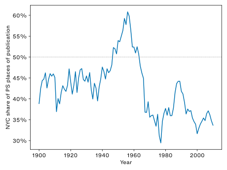
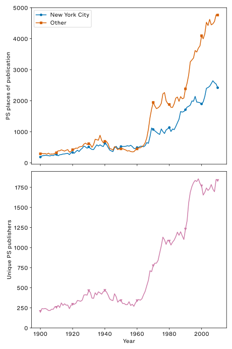

Co-authored with [Luca Messarra](https://english.stanford.edu/people/luca-messarra).

This project extends [previous work on nineteenth-century imprints](https://c19datacollective.com/data/capital-us-literature/).

## Accepted Manuscript

Below is the accepted manuscript of the article that appeared as:

Erik Fredner and Luca Messarra. “Leaving New York: The Dispersion of Twentieth-Century US Literary Publishing.” *American Literary History* 38, no. 4 (2026): 386–413. <https://doi.org/10.1093/alh/ajag058>

## Abstract

Who doesn’t believe that most US literature is published in New York City? Our analysis of 303,563 Library of Congress records reveals the expected rise followed by the unexpected fall of NYC in twentieth-century US literary publishing. NYC was only the place of publication for most works of US literature cataloged by the LC between 1947 and 1963, peaking in 1956 and declining sharply thereafter. That decline does not reflect decreased publishing in NYC, but increased publishing elsewhere. These findings nuance conventional narratives of conglomeration since consolidation of capital and proliferation of publishers happened simultaneously. Material approaches to literary history best explain these trends. As newer technologies displaced letterpress, older presses became available for cheap, allowing publishers outside NYC to flourish. New cataloging standards, NEA funding, and the rise of third-party distributors empowered the geographical expansion of US literary publishing. We demonstrate how this material approach enriches literary interpretation by reading Thomas Pynchon’s *Crying of Lot 49*. Recent US literary historiography has been undermined by the assumption that NYC’s qualitative dominance of US literary publishing entails its quantitative dominance. US literary histories benefit from attending to the supply-side of literary production, which reveals that the periphery is not peripheral.

## Introduction

> The independent small press movement has tried to broaden the base of literary culture, has sought to restore quality in the same spirit as does small farming. It has been an effort in cultural anarchism – decentralized, non-institutional, lacking in large measure any abstract standards in either the mechanical or editorial sense. But few of us believe, I think, that a thousand small presses (and a hundred underground newspapers) can muscle apart that grip laid on the world’s cultural resources by a couple of dozen New York City giants.
>
> —Len Fulton, *Directory of Little Magazines and Small Presses* (1970)

Who doesn’t believe that most American literature is published in New York City?[^1] Its status as the literary capital of the US has been unchallenged since the nineteenth century, when, as Alfred Kazin argued, William Dean Howells left the *Atlantic Monthly* in 1881 and took “the literary center of the country with him, as people said, from Boston to New York” (4). This essay extends previous work using data from the Library of Congress (LC) to study New York’s rise in American literary publishing over the nineteenth century by carrying it into the twentieth (Fredner). We reveal two major twentieth-century trends: the expected rise followed by the unexpected fall of New York City in the publishing of American literature. NYC only published most works of American literature cataloged by the LC between 1947 and 1963. The geographies of US literary imprints are more diverse than literary historians suspect. Recent US literary historiography has been undermined by the erroneous assumption that NYC’s qualitative dominance of American literature entails its quantitative dominance. This data should help the discipline begin to recalibrate this bias.

We will argue that this discovery about NYC’s rise and fall in post-war American literary history is best explained by changes in printing technology and the business of publishing, which nuance conventional narratives of consolidation and conglomeration that suggest concentration in NYC (Schiffrin). In summary, the cost of printing trade-quality books dropped throughout the mid-twentieth century due to cost-saving developments in printing and typesetting. Lower costs meant less capital required to begin publishing. As the printing industry invested in the latest innovations in offset lithography to meet demands, older offset presses and letterpress equipment became available for aspiring publishers throughout the nation for cheap. In conjunction with new standardizations in cataloguing, increased small press advertising, grant funding by institutions like the National Endowment for the Arts (NEA), and the rise of third-party distributors, declining costs deregionalized the small press—allowing small press publications to circulate nationally, and making it easier for American literary publishing to geographically expand beyond NYC, eventually making its way to the stacks on Capitol Hill. These changing conditions of textual production also manifest in some of the most canonical works of American literature, as we demonstrate in a new reading of Thomas Pynchon’s *The Crying of Lot 49*, which was published shortly after the beginning of NYC’s fall.

Many literary historians might question the extent to which place of publication matters, particularly today, where big publishers have offices all over the world, and where few (large) literary publishers actually print their own books. Ling Ma satirized this process in *Severance* with the Gemstone Bible, which is the product of a New York firm produced in Shenzhen. Our stance is that the assumption of NYC as the default place of publication conceals its changing fortunes. Even more importantly, it wrongly ignores *most* works of US literature, which are published elsewhere. For evidence of this ideological dominance in publishing more broadly, consider the most recent editions of *The Chicago Manual of Style* and the *MLA Handbook*, both of which eliminate the requirement to include place of publication in citations of books published after 1900 (*The Chicago Manual of Style* 14.30; *MLA Handbook* 5.67). While that transition indexes practical changes in the ways that the humanities finds its sources today, it also denotes a larger belief that place of publication is unimportant. Yet place of publication often matters a great deal for publishers outside of New York, who, among other things, help ensure that “regional” literature makes its way into print (Griswold). Just as the nationalization of news has obscured the ongoing significance of local politics, so too has the nationalization of literary culture—with NYC rather than DC at its center—obscured important communities publishing elsewhere.

## Library of Congress Data

In 2020, the LC released the latest public version of its machine-readable cataloging (MARC) Distribution Services dataset, MDSConnect. This dataset contains over 11 million records describing books cataloged by the LC with good coverage up to 2010. Of those, 303,563 are in the American literature range (PS), which is the focus of our analysis. While previous digital humanities research has used LC subject headings (Underwood), this project is the first to use MDSConnect data to study literary history.[^2]

Within PS, the LC collects “works by both established and new writers that are regarded as having literary merit, value, or significance, or as representing current trends in writing” (“LC Collections Policy Statements”). This includes major literary forms like poetry, fiction, and drama, as well as criticism and scholarship about American literature.[^3] It does not generally include self-published works, except for self-published materials by communities “underrepresented by the traditional commercial publishing industry,” including people of color, immigrants, queer people, and dissidents. The LC acknowledges some weaknesses in its American literature collection, including “relative weakness in holdings of books from alternative or small presses and little magazines” (“Collection Overview: American Literature”). We will return to this point about small presses soon.

These collecting policies reflect well-known biases in the history of the modern concept of literature, as well as in the selection practices of libraries and archives generally.[^4] However, we argue that the LC’s collecting practices remain a good proxy for publications studied by US literary historians *because* of these biases. If anything, such biases would seem likely to overrepresent NYC publications, which makes our discovery of NYC’s lower-than-expected prevalence even more surprising.

To do our analysis, we filtered the dataset for records in the American literature PS range, extracted their data, normalized and georeferenced their places of publication, and calculated annualized frequencies of places of publications using books’ publication dates. We normalize place names to account for variants (e.g., *N.Y.C.*) and typos (e.g., *New Yort*). We also count places of publication within the modern five boroughs like *Brooklyn* for NYC. For records with multiple places of publication (e.g., *New York and London*), we count each place of publication equally.

For almost all of US history—including every year after 1963—we find that most works of US literature preserved by the LC were *not* published with an NYC imprint. NYC is the most important place. But it is not the only place.

{#fig:nyc-share alt="A line chart showing the percentage of works of American literature cataloged by the Library of Congress published in New York City by year from 1900 to 2010. The share fluctuates between about 37% and 47% from 1900 through the early 1940s, then rises sharply in the late 1940s and early 1950s, crossing a dotted 50% reference line and peaking at 61% in 1956. After 1956, it falls steeply, reaching a new low of 29% in 1977. It rebounds briefly to the mid 40s in the late 1980s and early 1990s before trending downward again."}

During the twentieth century, only between 1947 and 1963 was more than half of US literature published in NYC. After peaking in 1956 with 61% of PS imprints, NYC falls to its nadir of 29% in 1977. This decline is not explained by changes in any particular range of the PS subclass. While they have slightly different peaks, all twentieth-century ranges within PS show a declining percentage of NYC imprints starting in the late 1950s to early 1960s, suggesting a systematic change.

That mid-century peak is all the more extraordinary given what follows it. Viewed from Midtown in the early 1950s, such a decline would have been hard to imagine. Yet the decline shown after 1956 does not actually reflect a decrease in NYC publishing. Instead, growth elsewhere outpaces it.

{#fig:records-publishers alt="Two panel figure. Left panel shows a line chart of PS publications per year from 1900 to 2010. It has two lines: one for New York City (blue) and all other locations treated as a group (orange). Both lines rise gradually to approximately 1940, dip slightly through the 1940s and 50s, then surge after the late 1960s. After the early 1960s, the orange line grows faster than NYC, reaching nearly 5,000 records per year by the end, whereas NYC peaks around 2,500. Right panel shows a line graph of unique publishers of works in the PS range by year from 1900 to 2010 with a single yellow line. The number of unique publishers per year follows a strikingly similar pattern to the “Other” line in the left panel. In 1900, the line begins below 250 unique publishers, increases to nearly 500 by 1940, declines through the late 1950s, then shows significant and sustained growth thereafter, with plateaus in the late 1970s-80s and between the late 1990s and 2010, ending at nearly 1,750."}

Before 1960, NYC and everywhere else (taken as a group) publish roughly similar shares of PS records. On or about 1964, a gap opens up and grows, leading to a far greater number of publications with imprints outside of NYC by the end of the twentieth century. Although information about changes in the material conditions of publishing is not directly captured by LC records, one way that we can see those impacts in the data is through the proliferation of unique publishers of American literature, shown in the right panel of Figure 2. By comparing the panels, we can see the strong correlation between the rise of unique publishers and the growth of publications outside of NYC. After NYC’s peak year of 1956, the odds of a new PS publisher having an NYC imprint fall to less than half of what they had been throughout the first half of the twentieth century.

Given this growth elsewhere, readers may wonder which place besides NYC predominates. The best answer to this question is that no single place does.

{#fig:maps alt="Two maps of the continental US with dots sized and colored on a log scale (purple = 1 record, yellow = 10,000+ records) showing records by location. Top map (1900–1956) shows concentration near NYC with scattered points elsewhere, including Boston, Philadelphia, Chicago, and San Francisco. Bottom map (1957–2010) shows that the Northeastern cluster is still the largest, but additional clusters have grown larger and more numerous nationwide, especially along the East, West, and Gulf coasts."}

The maps show increasing production in publication centers in the midwest (Chicago and Minneapolis) and in the Bay Area (San Francisco and Berkeley) after NYC’s peak. But we also see a proliferation of publishers throughout the lower forty-eight (with the pattern repeating in Alaska and Hawaii, too), validating Fulton’s account of the decentralization of publishing by the small press movement.

In the LC’s PS range, we see an inversion of the standard history of conglomeration. As shown in Figure 2, between 1940 and the mid-1950s, the number of publishers of American literature contracts, suggesting consolidation favorable to NYC. This matches both the standard narrative as well as the LC data. But, after the mid-1950s, the number of American literature publishers began to proliferate, correlating with decentralization, and putting pressure on the conventional story of increased consolidation in NYC. Consolidation of capital and proliferation of publishers happened simultaneously.

## Material Print Histories

With recognition that phenomena as large as these undoubtedly have various interconnected causes, we suggest the following as the best explanations for these geographical trends in post-war American literary publishing. Beginning around the 1950s, the US book manufacturing industry began seriously shifting toward offset lithography and phototypesetting—methods that encourage high-volume print runs. Economies of scale promoted by these technologies incentivized publishers inside and outside NYC to print larger runs of books with different effects. For NYC publishers, production costs incentivized printing fewer total books, shifting priorities toward very large runs of books that were expected to sell well (e.g., shrinking midlists, blockbuster approaches to publishing). For small publishers, these changes incentivized relatively larger runs that enabled them to sell nationally rather than regionally, if they desired. As the industry adopted these technologies, letterpresses subsequently became available for cheap, allowing presses outside of NYC such as Coffee House Press, Copper Canyon, and Graywolf to print ‘real books’ (in contrast with mimeo, ditto, and xerox publications) whose aesthetic would have been legible—and therefore archivable—as American literature. As Eileen Myles wrote from NYC in 1982 regarding mimeo publications: “Sure, it’s fast and it’s cheap but it doesn’t look like a book […] When someone asks me if I’ve got a book I say Yeah…but it’s just mimeo” (Myles). Furthermore, the emergence of national distributors and international cataloguing standards, coupled with NEA grant funding throughout the sixties and seventies, increased the visibility and viability of small presses outside of NYC. The presence of national funding encouraged local publications to professionalize and disseminate their works to a wider audience, promoting accessioning by the Library of Congress, which has an institutional mandate to collect materials from across the United States.

Conglomeration and stagflation stifled growth in the late seventies and throughout the eighties. From 1985 onward, desktop publishing software and typeset-quality digital printing reduced the capital and skilled labor necessary to publish a trade-quality book. The subsequent availability of print on demand (POD) in the 1990s and 2000s allowed anyone with a computer the ability to start their own publishing venture, increasing the number of presses and publications outside of NYC.

Our findings also present opportunities for scholars to explicate other narratives that we cannot cover in full: cheaper printing made it possible for American university presses to increase production in this period; changes in NYC itself increased production costs and decreased quality of life; conglomeration and its impacts on the profit motive possibly reduced the number of total books with New York imprints, decreasing the number of books on LC shelves even as the total number of copies of each book tended to increase.

Throughout, we stress that technological development is non-linear, and that its adoption is not entirely determinative of human activity. We also recognize that there were incremental transformations within the broader technologies and business practices discussed that are too numerous to give adequate time to here.[^5] Overall, we argue that US literary histories can benefit from attending to the supply-side of literary production, especially with respect to the way that centers of material production bias scholars’ intuitions about the geography of literary history.

### Offset lithography and phototypesetting transform publishing

In 1953, Albro T. Gaul's *The Wonderful World of Insects*, published by the NYC-based Rinehart & Company, became the first book to be entirely typeset using phototypesetters and printed using offset lithography (Gaul 291). Just fourteen years later in 1967, offset lithography surpassed letterpress in usage for book printing in America (*PW*, Nov. 1970, 14).[^6] Offset is the first important beat in the story we are telling about NYC publication because it reduces both capital and labor requirements for publishing, thereby reducing cost per volume, both making possible and incentivizing larger print runs from publishers.

While literary historians have written about the relationship between literature and other transformations in book production, the broad literary-historical significance of offset lithography has yet to be fully studied.[^7] Here, discussion of its ramifications will be concentrated on the speed and scale of book production enacted by its adoption by the publishing industry,[^8] as opposed to its more systemic reorganization of post-war literary aesthetics, which remains to be discussed elsewhere.[^9]

In order to understand offset’s significance, we must understand the technological limitations of what came before. Letterpress dominated book printing in the West from Gutenberg up until the mid-twentieth century. Its speed drastically increased with the advent of “hot metal” typesetting at the end of the nineteenth century, which utilized Monotype and Linotype machines (which devalued Mark Twain’s investments in the Paige Compositor) to mechanize the compositing process. Hot metal typesetting was the standard for trade printing until it was dealt a death blow by the industry’s adoption of phototypesetting or “cold type,” which emerged in the second half of the twentieth century as a quicker and less labor-intensive method for typesetting. Phototypesetting and the printing plates it facilitated allowed publishers to print longer runs faster and with lower labor costs, causing offset to take over industrial book production (Cockburn; Stein).

Instead of transferring ink from a raised surface onto paper as in letterpress printing, offset lithography uses an inked planographic plate (usually made of aluminum) to transfer an image to a rubber roller, which then transfers the image onto paper. Ira Rubel discovered this process around 1903, but it was not until the 1960s that the method became dominant in both large and small printing shops, largely as a result of relatively affordable, cathode-ray tube phototypesetting machines (whose type quality matched that of metal type) being released to the market, and publishers investing in the technology as way to break unionized typesetters’ power.[^10] Industry veteran Frank Romano particularly identifies Compugraphic’s 1968 “phototypesetter priced at about \$8,000 [about \$78,000 in 2026 dollars]” as the machine that “propelled phototypesetting into the mainstream, hastening the death of hot metal and increasing the use of offset lithography” (*Desktop Follies* 17).

Put simply, offset printing allows for longer, faster, and cheaper print runs compared to letterpress printing, providing the material conditions necessary for the accelerated growth—and conglomeration—of the publishing industry in the post-war period. Indeed, data presented in *A History of the Book in America* shows that the period from 1960 to 1965 (the period during which NYC falls below 50% of PS publications in Fig. 1)—the years where offset’s growth was beginning to displace letterpress—saw a ninety percent increase in new book titles and editions, which they argue is a growth greater than any other five-year period in twentieth-century American book production. (Miller, Nord 511 [table 3]).

One of offset’s major determinants over literary production is the fact that the capital investments required by the pre-press stage (i.e., platemaking) incentivizes book production at scale. Johanna Drucker explains that “the costs in all of these [offset’s] pre-press processes are as high for ten (good) copies as they are for ten thousand or more” (*Figuring the Word* 188). A 1968 estimate by Frank Petersen, then director of the New York and New Jersey based book manufacturing company American Book-Stratford Press, suggested a minimum print run of “7-10,000 copies for a small press, at least 10,000 for multicolor work,” lest offset prove financially disadvantageous (*PW*, April 1968, 60). Economies of scale incentivized by offset produced direct and indirect opportunities for big and small presses that initially benefited large NYC presses in the 1950s, but that ultimately tilted the geographical scales in favor of publishing outside of New York from the 1960s onward as costs for smaller runs fell. Affordable small runs of trade-quality books meant that publishers and authors could, in theory, succeed with local or national audiences without the need for NYC’s publishing resources.

As the rationalised center of the publishing industry, NYC would be the first to reap the benefits (and suffer the consequences) of any changes in book production.[^11] A print run of many thousands of copies would have been difficult for small publishers to meet when offset and phototypesetting first became dominant in the fifties and sixties, but feasible for established NYC presses who had the audience and capital to invest in large runs. Moreover, NYC’s major publishers—motivated by the financial prospects of bestsellers and reliable genre fictions—would have been eager to benefit from the economies of scale offered by the printing method. These larger print runs were accommodated by the emergence of book manufacturing hubs designed to facilitate huge offset print runs, such as Bertelsmann’s Offset Paperback Manufacturing (OPM), which opened in 1972 in Dallas, Pennsylvania, and was capable of pushing out “250 million to 300 million books a year” (*PW*, 26 May 1989, 18).[^12]

Although major NYC publishers would have been the first to benefit from the introduction of offset into industrial printing spaces in the 1950s, offset became cheaper for smaller publishers as the technology improved and as offset printers were set up across the nation. Len Fulton, who chronicled decades of small press activity in his annual directories, reports that only 17% of small presses used offset in 1960, using instead a combination of mimeograph and letterpress for printing. By 1974, 70% of small presses used offset (*International Directory of Little Magazines and Small Presses* 7). That adoption of the technology by small presses was incentivized by the minimum run size dropping throughout the twentieth century—largely as a result of innovations in phototypesetting that facilitated cheaper platemaking—settling at around 1,000 copies for an economically feasible print run, with POD today being typically used for runs smaller than this.[^13] It also was facilitated by cheaper and smaller offset duplicators released by A. B. Dick and Multilith in the 1950s, with Michael Davidson claiming that “the bulk of poetry published between 1956 and 1985 was produced on duplicators developed by A. B. Dick and Multilith that allowed for greater flexibility in layout and greater speed in publication” (*Ghostlier Demarcations* 30).

Constrained and encouraged by offset’s run size restrictions, small presses were incentivized to produce more copies of books than they might have with letterpress to take advantage of the economies of scale. For instance, in 1995, Charles Bernstein reported that the “printing bill” (not factoring in the cost of design, editing, publicity, etc.) for a usual print run at Sun & Moon Press, a poetry publisher and little magazine based at the time out of Los Angeles, “runs from \$2,600 to \$4,000 as you go from 1,000 to 2000 copies,” with 1,000 being the suggested minimum run size, lest the unit cost become too high (Bernstein 35). Here, printing an extra thousand copies reduces the cost per book by 23%, savings that compound exponentially as the size of the print run increases. An extra thousand copies in circulation would have meant a larger possible reading and purchasing audience for a non-NYC press. This is not to suggest that all regional presses aspired to the sort of broad national recognition and circulation that characterizes publishing with a large NYC house. Rather, it is to acknowledge the simple fact that presses were incentivized to increase their print runs in order to benefit from the economies of scale afforded and demanded by offset lithography, and that more books available meant a greater chance that a book published by a small press in, say, Los Angeles would attract readers and writers away from NYC publishers.

### For sale: letterpress and (old) offset printers

The growth in offset throughout the 1960s prompted a sharp decline in letterpress usage by industry printers, with major letterpress manufacturers ceasing production in the fifties and sixties. Symptomatic of this transformation, the sixth edition of the printer’s textbook *The Practice of Printing*, published in 1964, was the first edition to dedicate a chapter of the book to offset printing (Polk and Polk). That same year, Chandler & Price, one of the largest manufacturers of letterpresses in the United States, shut down their letterpress factory. The Vandercook family, who operated another significant American letterpress manufacturing company, followed suit by selling Vandercook in 1968 (ultimately stopping press production in 1976).

While the manufacturing of new letterpresses may have outright ceased by the mid 1970s, the letterpresses that already existed in the United States did not simply disappear. For example, The Chilton Company, a Philadelphia-based magazine and book publisher primarily known for their car repair manuals (and for publishing Frank Herbert’s *Dune* in 1965 after twenty other presses rejected the book), sold off forty flatbed letterpresses toward the end of the 1960s when they transitioned their book manufacturing technologies to offset printing (*PW*, June 1968, 82). Whether Chilton’s offloading of their letterpresses led to the creation of forty small presses is impossible to know; nevertheless, as industry printers continued to swap their letterpresses for offset presses, letterpresses became substantially cheaper through the mid-late twentieth century, opening up trade-quality bookmaking for smaller presses with lower budgets. Bernstein affirms that “as offset began to dominate the printing industry in the early 1970s, letterpresses became very cheap to acquire and innovative letterpress printers [...] could produce books with little other cash expense than paper costs and mailing” (Bernstein 38). Indeed, woven into the origin story of many of today’s most significant non-NYC presses such as Copper Canyon and countless other smaller printing initiatives like Lyn Hejinian’s Tuumba Press, is the purchase of a cheap letterpress, whose widespread availability and affordability was made possible by the transformation of industry printing around offset lithography.

Just as letterpress became affordable throughout the second half of the twentieth century, so too did offset. As newer offset presses and phototypesetters poured into the market on a yearly basis, older offset printers and typesetting equipment were made available at a discount. For instance, the leftist Detroit Printing Co-Op, co-founded in part by Fredy and Lorraine Perlman in late 1969, purchased an old Harris offset press to kickstart the co-op—as well as typesetting equipment from a local defunct print shop—out of which an entire decade of radical publishing emerged from Detroit (Aubert).[^14] The co-op had opted for the rather large and unwieldy offset press so that they could print books in addition to the political flyers that characterized the Detroit publishing scene. That foresight led to the publication and proliferation of the first “unauthorized” English translation of Guy Debord’s *The Society of the Spectacle* in 1970, which saw around 7,000 copies printed at the co-op (and another 23,000 with commercial printers once the co-op shut down in 1979) (Aubert 134-5). Offset facilitated the edition’s characteristic inclusion of images—as offset both allows sharper image reproduction and the seamless printing of images and text at the same time—a distinction which the 1967 French edition lacks.

As the co-op’s decision to purchase a larger press suggests, and as the Library of Congress’ acknowledged “weakness” in small press holdings proves, at stake in the adoption of letterpress and offset by a press is the legibility of their publications as “real” books (i.e., clear, uniform printing, quality binding), and subsequently, as objects that could be acquired as American literature by institutions such as the Library of Congress, and thereafter read as literary by historians. Scholars of the small press are familiar with the phrase “the mimeo revolution” as a buzzword to characterize the proliferation of small press activity that emerged in the post-war period following the advent of tabletop duplicators such as the mimeograph and ditto (and later, the risograph and xerox machines).[^15] Yet on practical, archival and ideological grounds, these publications have historically been illegible as literary objects, facilitating their exclusion from archives, canons, and literary histories. Practically, Michael Davidson describes “poetry produced on ditto or mimeo machines” as “not made to last but to circulate quickly, the fragility of its paper and the unevenness of its inking limiting both shelflife and aesthetic appeal. Staples rust, card stock fades, paper yellows and begins to flake” (*Ghostlier Demarcations* 28). Ideologically, rationalized book design (typeset quality print in trade paperbacks and hardcover books) retained and shaped the public image of the literary object, evidenced by Myles’ devaluation of mimeo publications. As letterpress and offset became more available throughout the second half of the twentieth-century, the aesthetic afforded by these methods of production would have been instrumental for ensuring an author’s and work’s legibility (and archivability) as American literature to the Library of Congress, to distributors and booksellers, and to a broader American readership.

### Deregionalizing “the small press”

The physical manufacturing of books is just one step in the production of American literature for the archive. Equally important are distribution and cataloging, which were instrumental for ensuring that smaller regional presses could operate outside major metropolitan hubs. Before the advent of standalone distributors, it was common practice for publishing houses to do their own distribution. That advantages bigger publishers who can dedicate the necessary capital and labor to manage distribution and warehousing, but is difficult work for smaller presses, especially those without established relationships with booksellers.

The increase in the productive abilities of printing technologies, and subsequently the number of books in circulation, prompted the development of robust book distribution networks, which publishers both in and outside of NYC used to have their books sold across the nation. Serendipity Books Distribution, later renamed to the better-known (and now defunct) Small Press Distribution, alongside today’s industry giant Ingram, both began distributing books in 1969. University Press of America and Publishers Group West, the two largest distributors in the 1980s, began distributing in 1975 and 1976 respectively (McDowell). These distributors alongside many more played a pivotal role in deregionalizing presses, exposing little known literary geographies to a national market. Even more important for the economics of publishing was the fact that distributors relieved presses from worrying about inventorying and shipping, allowing individuals with little business experience and capital to enter the publishing world.

As running a distribution business requires clear and consistent cataloging, it is no surprise that major distributors cropped up in the United States alongside the introduction of pivotal stockkeeping and cataloging methods, which helped streamline bookselling. Prior to the 1970s there existed no near-universally accepted cataloging standard for books. Standard Book Numbering (SBN) was developed and implemented in Britain in 1967, and emerged as the international standard that we now know as ISBN in 1970. The Library of Congress’s MARC standards and Cataloging in Publication Program came out in 1968 and 1971 respectively. In 1972, Ingram began selling its weekly microfiche catalog: a meticulously standardized list of books for sale that allowed bookstores and libraries anywhere in the nation to reliably purchase the latest publications (Hunt 39-49). These standardizations—by no means uniformly accepted—enabled niche works published outside of NYC to better circulate in a national literary marketplace by making them easy to find and order.[^16] They also produce their own unique “semantic charge,” as Craig Dworkin demonstrates in his compelling reading of the ISSN printed in Hejinian’s *Gesualdo* (“Hypermnesia” 85-6).

Bookselling requires advertisement, be it through word of mouth or through traditional advertising. Throughout the 1960s, periodicals and organizations emerged which documented the burgeoning small press movement across the nation, helping smaller publishers acquire readers and authors. In 1965, Len Fulton began publishing his annual *Directory of Little Magazines and Small Presses*, one of the most important records of the small press movement. Beginning as a humble staple-bound chapbook published out of his garage in El Cerrito, California, the publication transformed ten years later into a thick perfect-bound book so as to better accommodate its hundreds of pages filled with small press documentation. As a sign of institutional interest in the small press, in 1983 the industry giant Bowker launched *Small Press: The Magazine of Independent Book Publishing*, a periodical dedicated to highlighting small press ‘success’ stories, bringing the gaze of big publishing to bear on the small press.

The overall explosion of the small press also caught the eye of the National Endowment for the Arts. In 1975, the NEA acknowledged that “the economics of commercial publishing has forced major houses to virtually ignore new talent in recent years.”[^17] Recognizing that financially supporting “small circulation literary magazines and independent presses” was “crucial to the future of American literature,” the NEA in 1975 allocated \$266,095 to “encourage small non-profit presses to publish and distribute chapbooks by individual creative writers” (*1975 Annual Report* 5). That grant led to the production of over four hundred chapbooks, and of the seventy grants awarded, sixty were given to publishers located outside of New York. The money kept flowing in 1976 when \$345,000 was awarded to “independent presses” across the nation to directly support their publishing projects (*1976 Annual Report* 61). Come 1977, over \$500,000 was allocated as “assistance to small presses” to publish volumes that “otherwise would not be possible” (*1977 Annual Report* 69).

The NEA—alongside corporate philanthropists like the Ford Foundation—further funded the Coordinating Council of Literary Magazines (now known as CLMP, the Community of Literary Magazines and Presses), a New York-based organization which sought to consolidate the energies of the small press movement in order to “secure publicity, growth, and solvency for the ‘littles’” (Uchmanowicz 72). Amidst accusations of being “New York elites,” CCLM sought to “be more democratic” by holding biannual meetings outside of New York, and by intentionally funding and soliciting presses in other places. We will remain neutral as to whether or not the CCLM achieved their goals on a systemic level; Uchmanowicz records much debate in the small press world about CCLM’s purported democraticness, and there remains plenty of skepticism today about the interplay between non-profit organizations, government funding, and literary production.[^18] That said, one particular funding case might stand out for many literary historians: in 1972, Sam Hamill won a \$500 prize (around \$4,000 in 2026) from the CCLM for his editorial work with *Spectrum*, a journal based out of UC Santa Barbara. He then used that money to purchase a letterpress, from which Copper Canyon Press was born, which has brought forth award-winning books by writers such as W.S. Merwin, Natalie Diaz, Ocean Vuong, and Jericho Brown (Westdal 3).

These grants and organizations made possible books and presses that otherwise would not have been. Small presses were encouraged to aspire to larger distribution and increased documentation of their works in the hopes of securing national grants, which, upon being awarded, would have brought more readers and writers to a given small press. At the same time, plenty of individuals and communities were ambivalent or outright hostile to the idea of state and corporate funded literary production, such as poet, professor and publisher Felix Stefanile of *Sparrow* magazine, who referred to NEA grants as “‘cultural food stamps,’ that induce self-censorship in editors fearful of offending the ‘marble muse’ in Washington” (Lingeman).

### Conglomeration, Stagflation, Desktop Publishing

Beyond NYC’s decline in publishing dominance from 1956-77, figure 2 presents an intriguing phenomenon where the number of unique publishers stagnated in the late seventies before skyrocketing in the nineties. Simultaneously, figure 1 shows that the share of archived publishing done in NYC rises from 1978-89 before drastically falling again in the nineties. To account for the stifled growth of the late seventies and early eighties, we suggest conglomeration and stagflation. Dan Sinykin has detailed in *Big Fiction* and various venues how conglomeration consumed smaller publishers in the 1960s, particularly ramping up in the late seventies, so much so that in 1977 the Author’s Guild requested that the Department of Justice “break up the conglomerates,” with the Senate holding a hearing on the subject in 1980 (Childress). Sinykin further emphasizes 1977—the nadir of NYC publications of American literature in the twentieth century—as a particularly terrible year to be in the book business due to poor economic conditions across the nation (*Big Fiction* 5-6). As reading American literature is a (mild) luxury—and its production often unprofitable—it would make sense that non-corporate publishers would slow down in bad economies while bigger publishers begrudgingly carry on through the downturns.

The data shows that, come the nineties, other cities and unique publishers are back on the rise. In line with our interest in emergent technologies of book production influencing both output and geographic dispersal, we suggest that this return to dominance by other cities in the nineties and onward is associated with the introduction of desktop publishing and POD to the publishing world.

Desktop publishing is not one technology—it is a collection of hardware and software (the word processor, the laser printer, Postscript, etc.) whose advancements coalesced together around the 1980s to reshape book production.[^19] By 1986, desktop publishing software and laser printers were flooding the home market, deskilling the work of typesetting, and moving that labor from large photography and computer labs to cozy homes and corporate offices. Such new, expensive technologies would first benefit well-capitalized publishing in NYC—which peaked in geographical publishing against other cities in the late 80s relative to its late 70s nadir—before they worked their way into diffuse locations by the 90s and 2000s. This is to say nothing of the writing communities forming on Bulletin Board Systems (BBSes), and a few years later, blogs and forums across the World Wide Web, which were enabled by increased commercial access to computers.[^20]

Desktop publishing transformed typesetting, but it was the emergence of commercial print-on-demand bookmaking in the late nineties that democratized access to trade-quality, literary books.[^21] As its name suggests, POD uses digital printing and other automated technologies to print books the moment that they are ordered by a customer. That innovation has had many ramifications for literary history, but most important to this argument about the expansion of American publishing geographies is the elimination of the print run and the need for warehousing. With POD, practically zero startup capital needs to be invested into a book before it is published today. Anyone with the ability to bundle together a PDF can publish it as a physical book, make it available for purchase online, and have it shipped to any doorstep in the US within a week. Just-in-time production has led to the flowering of an unfathomable number of presses and publications, demonstrated in the data by the meteoric rise in unique publishers and imprint locations from the nineties onward. And critically, just as publishers using mimeo and ditto professionalized by adopting letterpress and offset in the seventies and eighties, more small press publications could be perceived as literary by trading out the work of the photocopier and stapler—instrumental for the production and proliferation of zines through the nineties and into the present—for perfect bound, digitally printed books.

One significant literary-historical example is Black Classic Press, founded in 1978 in Baltimore by Paul Coates (father of Ta-Nehisi Coates) when he purchased a Xerox machine and began publishing out-of-print and other rare Black literature from his basement. Coates’s production skyrocketed in 1996 when he began leasing a \$300,000 Xerox DocuTech, released in 1990 as the first all-in-one POD bookmaking machine. Upon the DocuTech, Coates launched the first Black-American centered POD publishing and printing initiative, which made its name by publishing Walter Mosley’s *Gone Fishin’* in 1997.[^22] It was the DocuTech and the power of POD that allowed Coates’s press to go from publishing twelve to sixteen books annually to three hundred on-demand books a year (Singletary). And that increase is the story of just one press, well before Ingram and Amazon further rationalized POD publishing at the turn of the millennium.

John Ingram saw the DocuTech in action at BookExpo America in the mid 90s, spawning the Ingram Company’s interest in POD. Lightning Source (Ingram’s POD division) printed their first POD book in 1998: galleys of Trish MacGregor’s mystery thriller *The Hanged Man*, published by Kensington Books. By 2008, Ingram had one million titles in their print library, and had reached fifteen million titles in 2018 (Milliot). Similarly, Amazon entered the POD market when they acquired South Carolina based BookSurge in 2005, eventually integrating POD into their Kindle Direct Publishing ebook service in 2016.[^23] In spite of frequently discussed contemporary fiction detailing the lives of writers navigating the New York publishing scene, POD has ushered in a new era of professional self-publication that can be separated from NYC publishing.[^24]

## Conclusion

What do material histories of publishing, such as our focus on imprint geographies and printing technologies, offer literary studies? Throughout, we have argued that the history of printing technology and the business of publishing are useful contexts for thinking through the geographic dispersal and aesthetic of what may be archived as American literature. But material histories can also help literary historians make sense of the publishing politics written—literally and figuratively—into some of the most canonical works of American literature. The task of the materially-oriented literary historian is to become familiar with a period’s specific changes in production, so as to understand how writers are influenced by, and have innovatively responded to, their textual conditions. To that end, we offer a brief reading of *The Crying of Lot 49* that captures the changing imaginary around New York publishing brought about by the emergence of new printing technologies in the 1960s, and the attendant explosion of new publishers of American literature.

That Pynchon would mock the publishing industry in his second book is perhaps unsurprising. He had purportedly been frustrated with his publisher, the Philadelphia-based Lippincott, at the time of writing *Lot 49*, with Boris Kachka asserting that Pynchon “saw *Lot 49* as a quickie ‘potboiler’ meant to break his option with the house—forcing them to either reject it, liberating him, or pay him \$10,000” (“On the Thomas Pynchon Trail”). That desire to break his contract with Lippincott would have likely been fueled by his frustration with their hardcover printing of his debut 1963 novel *V.*, featuring numerous typos and content errors which went uncorrected in reprints (likely because the type had already been set, and fixing it would have been costly for Lippincott) despite Pynchon’s protesting, prompting him to call it “the worst novel in decades” (Rolls).

Having lived on and off in New York City and written about it extensively in *V.*, Pynchon was familiar with the state of publishing by the time he was writing *Lot 49*, which he penned at a cozy distance from the East coast publishing world in sunny California. The novel follows Oedipa Maas, driven by paranoia and a lust for connection, as she tries to make sense of diffuse clues left by a centuries-old secret postal society. Midway through the story, Oedipa attempts to learn more about the word “Trystero,” uttered in a live performance of *The Courier’s Tragedy*, written by the fictitious Jacobean playwright Richard Wharfinger. Oedipa visits the director backstage and inquires about the script, only to discover that “they were all purple, Dittoed—worn, torn, stained with coffee,” (*Lot 49* 60) a nod to the distinct aesthetic and the fragility of works reproduced using a spirit duplicator—which countless individuals and presses used to cheaply print short runs of texts (including the first twenty-five copies of Allen Ginsberg’s *Howl*, printed six months before the infamous City Lights edition) throughout the twentieth century (Morgan 1). Oedipa then inquires about “the original” and is told to consult a paperback anthology titled *Jacobean Revenge Plays* (*Lot 49* 61). She acquires the paperback and tracks down its source text, a hardcover textbook titled *Plays of Ford, Webster, Tourneur and Wharfinger*. Much to her frustration, she discovers that “the original” paperback’s line about Trystero is missing from the hardcover, despite the fact that “the paperback was supposed to be a straight reprint of the book” (*Lot 49* 81). This discrepancy prompts her to consult the hardcover’s editor, Professor Emory Bortz, a former UC Berkeley English professor:

> Oedipa showed him the paperback with the line in it. Bortz, squinting at the page, groped for another beer. ‘My God,’ he announced, ‘I've been pirated, me and Wharfinger, we've been Bowdlerized in reverse or something.’ He flipped to the front, to see who'd re-edited his edition of Wharfinger. ‘Ashamed to sign it. Damn. I'll have to write the publishers. K. da Chingado and Company? You ever heard of them? New York.’ He looked at the sun through a page or two. ‘Offset.’ Brought his nose close to the text. ‘Misprints. Gah. Corrupt.’ He dropped the book on the grass and looked at it with loathing. (*Lot 49* 124-5)

Here, New York alongside offset lithography comes to be associated with illicit, inaccurate, and little known publications.[^25] “You ever heard of them?” suggests a surge in New York publishers in the 1960s, who had become relatively obscure even amongst Berkeley academics like Bortz. Meanwhile the Spanish homophonic pun “K. da Chingado” (roughly equivalent to “what the fuck”) operates as an insult flung at The Big Apple from Los Angeles.

The significance of this passage and the bulk of its NYC critique is amplified by bearing in mind the original publication of Bortz’ book: a hardcover textbook—as opposed to K. da Chingado’s paperback— “published by The Lectern Press, Berkeley, California, back in 1957” and later retrieved by Oedipa from a “warehouse in Oakland” upon not being able to find it at the publisher’s office in Berkeley (*Lot 49* 72, 81). The pirating of a Bay Area hardcover into an offset printed paperback metonymically implicates New York publishers as creators of aesthetically inferior, pirated works by ‘small’ California publishers, intimating a predatory reliance on the periphery by the US literary center.

We unlock exciting, sociological readings of the whole novel when we attend to the presence of these processes of textual production within Pynchon’s work. The “corrupt[ion]” of Bortz’ book becomes a jab at Lippincott’s typesetting errors and a culture of cheap and voluminous printing generally; Oedipa’s profound confusion around being a first time executrix of a will at 28 becomes a projection of Pynchon’s own anxieties around fulfilling his book contract with Lippincott (especially given that *Lot 49* was published when Pynchon himself was 28); the novel’s violent postal monopoly, Thurn and Taxis, and its suppression of rival company Trystero, comes to represent the nascent forces of conglomeration that were beginning to take over book production in the 1960s. All told, understanding the material publishing histories of the sixties enriches our scholarly understanding of *The Crying of Lot 49*, allowing us to see it as a commentary on emergent printing technologies, and more pointedly, a criticism of offset’s transformation of New York into a scandalous space built on alienated literary printing.

By analyzing catalogue records created by librarians at the Library of Congress, we have shown that, contrary to a widespread assumption among literary historians, NYC only published most works of US literature for a brief period from 1947 to 1963. We argue that this provides evidence of bias towards NYC in US literary histories, suggesting a need to decenter NYC in narratives of post-war American literature by recognizing that the periphery is not peripheral. Moreover, the LC’s collecting biases would likely privilege NYC imprints, meaning that the geographic dispersal may be even greater than the available evidence suggests. To the extent literary historians of the twentieth century and beyond fail to recognize this, they continually misrepresent their object. Returning to our opening epigraph, Len Fulton suspected that NYC’s “grip” over “the world’s cultural resources” could not possibly be surmounted by independent presses outside of New York. It may be true that NYC possesses the most economic and cultural capital in the world of Anglophone literary publishing, but that does not mean it is the sole proprietor of those things. Constructing representative US literary histories will depend on the field’s ability to recognize, document, and discuss the majority of American literary publications.

Our findings suggest the need for more regional literary histories, which would demonstrate the significance of publishing outside of NYC. For the humanities more broadly, the present-day stakes of attending to local publishing communities cannot be understated. Literary history already shows the importance of such work. When Ferlinghetti and Murao were arrested in 1957 for the publication of *Howl*, local critics, scholars, and educators testified in their defense (Black). Following Baraka’s arrest during unrest in Newark in 1967, Judge Kapp read his biting poem “Black People!” aloud to the jury, and “based the severity of Jones’s [Baraka’s] punishment” on the content of the poem (Freind). In response, Ashbery, Creeley, di Prima, and thirteen other major poets declared his innocence, issuing a “herald to literary persons: get on the ball for LeRoi Jones, or else get off the poetic pot” (Committee on Poetry).[^26] These actions by readers and writers were possible and efficacious because they were paying attention to both local publications and the movements happening around them.

In that spirit, allow us to conclude by noting an ongoing story of local publishing with national significance. As we finish this essay in mid 2026, the Dallas-based publishing duo Elizabeth and Ines Soto have just been sentenced to fifty years in federal prison, following their participation in protests at an ICE detention center in Alvarado, Texas, which culminated in another protestor shooting a police officer non-fatally (though neither of the Sotos were at the scene when the shooting occurred). Their sentencing length, enhanced by the Department of Justice labeling the protest participants as an “Antifa cell,” has been characterized by Georgetown Law professor Paul Butler as “extremely harsh” (Rogin). Some of the evidence the federal government used against them includes organizing an anarchist reading group, and printing zines with a “standard office printer, a paper cutter and a book binder.” The Trump administration used this to convict them of “providing material support to terrorists” (McMenamin).[^27] As a part of the same prosecution, Daniel “Des” Sanchez Estrada was sentenced to thirty years for transporting a box of their zines. These publishers are part of the long history of dissentious American publishing—from Revolutionary pamphleteering in Philadelphia to the Black Arts Movement in Harlem, Chicago, Detroit, and beyond. They demonstrate how conflicts between independent publishers and the State continue to drive history, and they show the great significance of small publishing. We risk missing such stories—and the human beings behind them—when we fix our attention on Midtown instead of what’s going on in neighborhood print shops, bookstores, and archives. Redirecting that attention could also ensure that such documents are preserved for future scholarship at the Library of Congress and elsewhere.

## Data Availability Statement

The Library of Congress and geocoding data underlying this article are publicly available. Code used to download and analyze the data, as well as generate the figures is available via Zenodo at <https://doi.org/10.5281/zenodo.21245095>.

## Works Cited

::: {.works-cited}
Asheim, Lester. “Not Censorship But Selection.” *Wilson Library Bulletin*, no. 28, Sept. 1953, pp. 63–67, <https://www.ala.org/advocacy/intfreedom/NotCensorshipButSelection>.

Aubert, Danielle. *The Detroit Printing Co-Op: The Politics of the Joy of Printing*. Inventory Press, 2019.

Battershill, Claire. *Women and Letterpress Printing 1920-2020: Gendered Impressions*. Cambridge University Press, 2022.

Bernstein, Charles. “The Economics of the Small Press: Poetry Publishing” *Talking the Boundless Book: Art, Language, & the Book Arts* edited by Charles Alexander, Minnesota Center for Book Arts, 1995, pp. 33-44.

Black, Joel E. “Ferlinghetti on Trial: The Howl Court Case and Juvenile Delinquency.” *Boom*, vol. 2, no. 4, Dec. 2012, pp. 27–43, <https://doi.org/10.1525/boom.2012.2.4.27>.

“Books All (Database).” *The Library of Congress Cataloging Distribution Service*, 26 June 2024, <https://www.loc.gov/cds/products/product.php?productID=5>.

Casper, Scott E., editor. *The Industrial Book, 1840-1880*. Published in association with the American Antiquarian Society by the University of North Carolina Press, 2007. A History of the Book in America.

Charvat, William. *Literary Publishing in America, 1790-1850*. University of Massachusetts Press, 1993.

Childress, Clayton. “Life inside the Fiction Factory: Dan Sinykin on Conglomerate Publishing,” *Public Books*, 24 Jan. 2024, <https://www.publicbooks.org/life-inside-the-fiction-factory-dan-sinykin-on-conglomerate-publishing/>.

Clay, Steven and Rodney Phillips. *A Secret Location on the Lower East Side: Adventures in Writing 1960–1980*. Granary Books, 1998.

Cockburn, Cynthia. *Brothers: Male Dominance and Technological Change*. Pluto Press, 1983.

“Collection Overview: American Literature.” Library of Congress, Oct. 2007, <https://www.loc.gov/acq/devpol/colloverviews/amerlit.pdf>.

Committee on Poetry. “LeRoi Jones.” *The New York Review of Books*. April 25, 1968. <https://www.nybooks.com/articles/1968/04/25/leroi-jones/>

Davidson, Michael. *Ghostlier Demarcations: Modern Poetry and the Material Word*. University of California Press, 1997.

Drucker, Johanna. *Figuring the Word: Essays on Books, Writing, and Visual Poetics*. Granary Books, 1998.

Dworkin, Craig. “Hypermnesia,” *Boundary 2* vol. 36, no. 3, Aug. 2009, pp. 77-95.

Erickson, Lee. *The Economy of Literary Form: English Literature and the Industrialization of Publishing, 1800-1850*. Johns Hopkins University Press, 1995.

Fredner, Erik. Erikfredner/Imprints. Version v0.1.0, Zenodo, 7 July 2026. DOI.org (Datacite), <https://doi.org/10.5281/ZENODO.21245096>.

Fredner, Erik. “Moving the Capital of US Literature from Boston to New York: Evidence from 11 Million Library of Congress Records.” Version 1, *C19 Data Collective*, 2024. <https://doi.org/10.34770/XCGB-ZN76>.

Freind, Bill. “‘Up Against the Wall, Motherfucker’: The History of a Phrase.” *Canadian Review of American Studies*, vol. 54, no. 3, Dec. 2024, pp. 302–21. DOI.org (Crossref), <https://doi.org/10.3138/cras-2024-003>.

Frutiger, Adrian. “Typography with the IBM Selectric Composer” *Visible Language* vol. 1, no. 3, 1967. <https://journals.uc.edu/index.php/vl/article/view/5002>.

Fulton, Len. *Directory of Little Magazines and Small Presses*. Dustbooks, 1970.

Fulton, Len. *International Directory of Little Magazines and Small Presses*. Dustbooks, 1974.

Furrie, Betty. *Understanding MARC Bibliographic: Machine-Readable Cataloging*. 2009, <https://www.loc.gov/marc/umb/>.

Gaul, Albro T. *The Wonderful World of Insects*. Rinehart & Company, 1953.

Griswold, Wendy. *American Guides: The Federal Writers' Project and the Casting of American Culture*. University of Chicago Press, 2016.

Griswold, Wendy. *Regionalism and the Reading Class*. University of Chicago Press, 2007.

Gross, Robert A., and Mary Kelley, editors. *An Extensive Republic: Print, Culture, and Society in the New Nation, 1790-1840*. Published in Association with the American Antiquarian Society by The University of North Carolina Press, 2010. A History of the Book in America.

Grossman, Claire, et al. “Literature’s Vexed Democratization.” *American Literary History*, vol. 33, no. 2, May 2021, pp. 298–319. <https://doi.org/10.1093/alh/ajab003>.

Guillory, John. “The Location of Literature.” *A Companion to Literary Theory*, John Wiley & Sons, Ltd, 2018, pp. 151–64. *Wiley Online Library*, <https://doi.org/10.1002/9781118958933.ch12>.

Hattery, Lowell H. and George P. Bush. *Technological Change in Printing and Publishing*. Spartan Books, 1973.

Hughes-Watkins, Lae’l. “Moving Toward a Reparative Archive: A Roadmap for a Holistic Approach to Disrupting Homogenous Histories in Academic Repositories and Creating Inclusive Spaces for Marginalized Voices.” *Journal of Contemporary Archival Studies*, vol. 5, no. 1, May 2018. *COinS*, <https://elischolar.library.yale.edu/jcas/vol5/iss1/6>.

Hunt, Keel. *The Family Business: How Ingram Transformed the World of Books*. Mint Editions, 2021.

Hutner, Gordon. *What America Read: Taste, Class, and the Novel, 1920-1960*. University of North Carolina Press, 2009.

Johns, Adrian. *Piracy: The Intellectual Property Wars from Gutenberg to Gates*. University of Chicago Press, 2009.

Kachka, Boris. “On the Thomas Pynchon Trail: From the Long Island of His Boyhood to the ‘Yupper West Side’ of His New Novel,” *Vulture*, 25 Aug. 2013.

Kazin, Alfred. *On Native Grounds: An Interpretation of Modern American Prose Literature*. Reynal & Hitchcock, 1942.

Kelber, Harry, and Carl Schlesinger. *Union Printing and Controlled Automation*. The Free Press, 1967.

Kirschenbaum, Matthew G. *Track Changes: A Literary History of Word Processing*. Belknap Press, 2016.

“Library of Congress Classification Outline.” *Library of Congress*, 22 May 2024, <https://www.loc.gov/catdir/cpso/lcco/>.

“Library of Congress Collections Policy Statements: Literature and Language (Classes P-PZ and Sections of Class Z).” Library of Congress, Mar. 2022, <https://www.loc.gov/acq/devpol/litlang.pdf>.

Lingeman, Richard R. “Book Ends: Not So Little Magazines,” *The New York Times*, 5 June 1977, <https://www.nytimes.com/1977/06/05/archives/book-ends-not-so-little-magazines-demographics-trends-independence.html>.

Loewenstein, Joseph. *The Author’s Due: Printing and the Prehistory of Copyright*. University of Chicago Press, 2002.

Ma, Ling. *Severance*. Farrar, Straus and Giroux, 2018.

Makala, Jeffrey M. *Publishing Plates: Stereotyping and Electrotyping in Nineteenth-Century US Print Culture*. Penn State University Press, 2023.

*MARC 21 Format for Bibliographic Data: Table of Contents (Network Development and MARC Standards Office, Library of Congress)*. Dec. 2024, <https://www.loc.gov/marc/bibliographic/>.

Mariani, Letizia. *The Social Life of Poetry*. 2026. University of California, Irvine, PhD dissertation. <https://escholarship.org/uc/item/6vc0h2q1>.

McDowell, Edwin. “The Media Business; University Press Becomes Big Distributor for Small Publishers,” *The New York Times*, 27 Nov. 1989, p. 8.

McGurl, Mark. *Everything and Less: The Novel in the Age of Amazon*. Verso, 2021.

McMenamin, Lex. “‘This Is Injustice’: How Leftist Zines Were Used to Sentence Anti-ICE Protesters to Decades in Prison.” *The Guardian,* 24 June 2026. <https://www.theguardian.com/us-news/ng-interactive/2026/jun/24/prairieland-texas-ice-protests-zines>.

Michelson, Mark. “Bertelsmann Closes Offset Paperback Manufacturers,” *Printing Impressions*, 16 May 2024, <https://www.piworld.com/article/bertelsmann-closes-offset-paperback-manufacturers-book-printing-plant/>.

Miller, Laura J. and David Paul Nord, “Reading the Data on Books, Newspapers, and Magazines: A Statistical Appendix” *A History of the Book in America: Volume 5: The Enduring Book: Print Culture in Postwar America* edited by Michael Shudson et al., University of North Carolina Press, 2009, pp. 503-518.

Milliot, Jim. “Lightning Source Turns 20,” *Publishers Weekly*, 16 Nov. 2018, <https://www.publishersweekly.com/pw/by-topic/industry-news/manufacturing/article/78626-lightning-source-turns-20.html>

*MLA Handbook*. 9th ed., The Modern Language Association of America, 2021.

Morgan, Bill. *The Works of Allen Ginsberg 1941-94: A Descriptive Bibliography*. Greenwood Press, 1995.

Myles, Eileen. “Mimeo Opus.” *The Poetry Project Newsletter*, no. 89, 1982.

*1975 Annual Report*. National Endowment of the Arts, 1975. <https://www.arts.gov/sites/default/files/NEA-Annual-Report-1975.pdf>

*1976 Annual Report*. National Endowment of the Arts, 1976. <https://www.arts.gov/sites/default/files/NEA-Annual-Report-1976.pdf>

*1977 Annual Report*. National Endowment of the Arts, 1977. <https://www.arts.gov/sites/default/files/NEA-Annual-Report-1977.pdf>

Olson, Hope A. “The Power to Name: Representation in Library Catalogs.” *Signs: Journal of Women in Culture and Society*, vol. 26, no. 3, Apr. 2001, pp. 639–68. *journals.uchicago.edu (Atypon)*, <https://doi.org/10.1086/495624>.

Polk, Ralph W. and Edwin W. Polk. *The Practice of Printing: Letterpress and Offset*. Chas. A. Bennett, 1964

*Publishers Weekly*. 1 Apr. 1968.

*Publishers Weekly*. 10 Jun. 1968.

*Publishers Weekly*. 23 Nov. 1970.

*Publishers Weekly*. 26 May 1989.

Pynchon, Thomas. *The Crying of Lot 49*. Harper Perennial Modern Classics, 2006.

Rogin, Ali. “Anti-ICE Protesters Sentenced to Decades in Prison in Latest Crackdown on Dissent.” 24 June 2026, <https://www.pbs.org/newshour/show/anti-ice-protesters-sentenced-to-decades-in-prison-in-latest-crackdown-on-dissent>.

Rolls, Albert. “The Two V.s of Thomas Pynchon, or From Lippincott to Jonathan Cape and Beyond” *Orbit: A Journal of American Literature* vol. 1 no. 1, 2012.

Romano, Frank. *Desktop Follies*. GAMA, 1999.

Romano, Frank. *History of Desktop Publishing*. Oak Knoll Press, 2019.

Schierloh, Eric. *ISBN? No Thanks and Other Notes Before Starting a Publishing House*. Public Collectors, 2026.

Schiffrin, André. *The Business of Books: How International Conglomerates Took over Publishing and Changed the Way We Read*. Verso, 2001.

Singletary, Michelle. “Opening a New Chapter in Publishing,” *The Washington Post*, 30 Mar. 1997, <https://www.washingtonpost.com/archive/business/1997/03/31/opening-a-new-chapter-in-publishing/9731132c-f67d-42ed-ab76-61079df7bddc/>.

Sinykin, Dan. *Big Fiction*. Columbia University Press, 2023.

Smith, Barbara Herrnstein. *Contingencies of Value: Alternative Perspectives for Critical Theory*. Harvard University Press, 1991.

Solomon, Samuel. “Offsetting Queer Literary Labor,” *GLQ: A Journal of Lesbian and Gay Studies* vol. 24, no. 2–3, June 1, 2018), pp. 239-66, <https://doi.org/10.1215/10642684-4324801>

Stein, Jesse Adams. *Hot Metal: Material Culture and Tangible Labour*. Manchester University Press, 2016.

Tebbel, John William. *A History of Book Publishing in the United States*. Clock & Rose Press, 2003. 4 vols.

*The Chicago Manual of Style*. 18th ed., The University of Chicago Press, 2024.

Uchmanowicz, Pauline. “A Brief History of CCLM/CLMP,” *The Massachusetts Review* vol. 44, no. 1/2, 2003, pp. 70-87

Underwood, Ted. “The Life Cycles of Genres.” *Journal of Cultural Analytics*, vol. 2, no. 2, May 2016. culturalanalytics.org, <https://doi.org/10.22148/16.005>.

Waggoner, Walter H. “LeRoi Jones Jailed for 2 ½ to 3 Years on Gun Charge.” *The New York Times*. 05 Jan. 1968. *ProQuest*, <https://www.proquest.com/newspapers/leroi-jones-jailed-2-1-3-years-on-gun-charge/docview/118337522/se-2>.

Westdal, Jenny. *The Printed Word in Port Townsend: Literary Presses of the 1970s and 1980s*. The Jefferson County Historical Society, 2016.

Zinn, Howard. “Secrecy, Archives, and the Public Interest.” *The Midwestern Archivist*, vol. 2, no. 2, 1977, pp. 14–26. *JSTOR*, <https://www.jstor.org/stable/41101382>.
:::

[^1]: See Charvat; Tebbel; Casper; Gross and Kelley.

[^2]: This essay does not discuss most technical details of the analysis. Interested readers can find them in the project repository, which contains code to reproduce our results: <https://doi.org/10.5281/zenodo.21245096>.

[^3]: Readers may wonder what proportion of PS records are primary sources versus secondary sources. There is no perfect way to draw this distinction using MARC records alone. We created a set of rules documented in the repository to attempt this distinction using features like LC subjects and form codes. We find that 10.7% of PS records are likely secondary literature. Excluding them from the analysis does not change any of our core findings. For this reason, our findings report data from all available PS records.

[^4]: See Smith; Guillory; Hutner; Asheim; Zinn; Olson; Hughes-Watkins.

[^5]: One example is the release of the IBM Selectric Composer in 1966, which offered simplified, customizable typesetting for individuals and smaller presses, driving down the labor and capital cost of book manufacturing. See Frutiger.

[^6]: Per Loren Miller, chief economist of the Harris-Intertype Corporation.

[^7]: One notable exception is Solomon, who discusses the relation between mid-century changes in typesetting and the works of Karen Brodine. Scholars have written about other book production methods and their effects on literary history. See Battershill for twentieth and twenty-first century letterpress, Erickson; Makala for the nineteenth century, and Loewenstein for the early modern period.

[^8]: Throughout, “publishing industry” will be used to signify the activities of conventional trade publishing as opposed to individual artist, private press, and other small printing initiatives.

[^9]: Messarra’s book project addresses this subject in full.

[^10]: International Typographical Union conflicts with NYC publishers in 1948 and 1962-3 likely prompted publishers to invest in and adopt phototypesetting and thereby offset printing. See Hattery and Bush; Kelber and Schlesinger.

[^11]: As a New York union periodical boasted in 1963, “the fact is that New York City has a greater quantity of diversified printing equipment than any city on earth.…The fact is that New York City has a larger number of highly skilled craftsmen than any city on earth” (qtd. in Kelber and Schlesinger 203).

[^12]: OPM shut down in 2024 amidst a decline in demand for giant print runs, which few books rarely achieve (Michelson).

[^13]: Given technological variability in printing shops and book design, it is difficult to get precise numbers for historical run costs. Interested readers might consult various tables in the USITC’s report on print manufacturing, “Study of the Economic Effects of Terminating the Manufacturing Clause of the Copyright Law,” *United States International Trade Commission*, 1983, particularly table 29, which breaks down the average price per book for various run sizes.

[^14]: Other contemporaneous, literary historically significant presses in Detroit include Dudley Randall’s Broadside Press, Naomi Long Madgett’s Lotus Press, and Ken and Ann Mikolowski’s The Alternative Press.

[^15]: The literature on “the mimeo revolution” is extensive. For a primer, see Clay and Phillips, whose work identifies the geographical diversity of the revolution beyond Ed Sanders’ “SECRET LOCATION IN THE LOWER EAST SIDE.”

[^16]: A trip to your local small press fair will make clear that many publishers still do not bother with ISBNs. As Argentine publisher Eric Schierloh puts it, “if our publications are not international, nor standard, nor exclusively books, then why and what is the ISBN for?” (Schierloh 8).

[^17]: See also Alexander Manshel’s recent contribution to the Post45 Data Collective, “The National Endowment for the Arts Creative Writing Fellowships (1965-2024),” which provides a “comprehensive list of the writers sponsored by National Endowment for the Arts fellowships from the organization’s founding in 1965 to 2024, including information about those writers’ demographics, education, and geography.” NYC writers as a single geographical space received the most amount of awards (at least 347 writers listed their hometown as New York), but that is peanuts compared to the 3700+ awards given by the NEA over the period of study.

[^18]: Amy Paeth refers to the connection between state and private interests as “state verse culture” in *The American Poet Laureate: A History of U.S. Poetry and the State*. R.M. Haines frequently critiques “literary exceptionalism” as “the belief that literature is a calling, a practice that is essential both to humanity and democracy, and that it is immune from economic critique,” situating that exceptionalism as an essential element for American imperialism. See various writings on R.M. Haines’ Substack “Out of Its Wooden Brain.”

[^19]: See Romano 2019 for the history of these individual technologies. See also Kirschenbaum for a focus on word processors.

[^20]: Readers interested in a sample of BBS fiction might browse Jason Scott’s archive at <http://www.textfiles.com/directory.html>, where goodies can be found such as the Rhode Island based “E-Mag” *Astral Avenue* (1986-7), whose first issue lampoons Stephen King’s writing as akin to “pigeontracks in cement.”

[^21]: Democratized access to publishing does not necessarily translate to a diverse literary field. See Grossman, Spahr, and Young 2021.

[^22]: Notably, the print run for that book of national scale was far too large for the small printing initiative to handle, which prompted Coates to outsource the printing to the manufacturing giant RR Donnelley based in Chicago, and the distribution to Publishers Group West.

[^23]: See McGurl on KDP.

[^24]: These works include Ben Lerner’s *10:04*, Tao Lin’s *Taipei*, R.F. Kuang’s *Yellowface*, and Zakiya Dalila Harris’ *The Other Black Girl*, which are all set against the backdrop of NYC publishing. Messarra’s book project discusses these “metapublishing fictions” in relation to the advent of POD.

[^25]: Coupled with the fact that the content in the collected works is that of an early modern playwright, the passage overall likens the state of publishing in the 1960s to that of the early modern period, where book piracy ran rampant. See Loewenstein; Johns.

[^26]: The authors would like to thank Letizia Mariani for bringing the Baraka case to our attention. Mariani writes at length about the case, its afterlife, and the social uses of poetry in the first chapter of her doctoral dissertation, *The Social Life of Poetry* (2026).

[^27]: Readers who wish to view these zines may purchase them at <https://firestorm.coop/products/25308-the-government-doesnt-want-you-to-read-these-zines.html>. Sales benefit the Prairieland Defendants.
